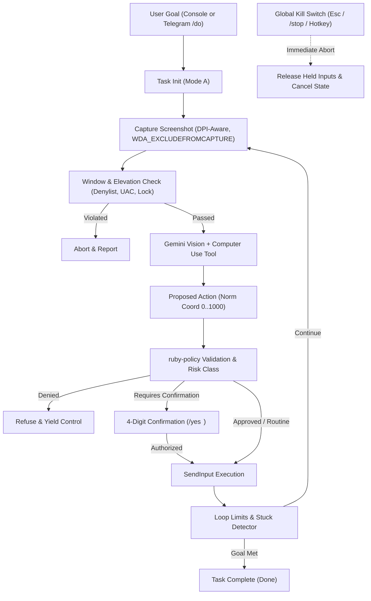

# Milestone M4 Design: Live Computer Use (Mode A)

**Author**: Ruby Assistant Team  
**Date**: 2026-11-18  
**Repository**: `Syed-Haseeb97/ruby-agent`  

---

## 1. Overview & Architecture

Milestone M4 establishes Ruby's **Mode A Live Computer Use** engine: a secure, visible, model-guided autonomous desktop operator. The agent captures the user's desktop, identifies interactive UI affordances, submits screenshots to the Gemini multimodal reasoning pipeline, verifies proposed actions against `ruby-policy`, and executes them via native Windows `SendInput`.

---

## 2. Action Set

All coordinates are normalized to a standard $[0, 1000]$ virtual bounding box matching the Gemini Computer Use specification, mapped to physical monitor pixel coordinates via DPI scaling:

| Action Name | Parameters | Description |
|---|---|---|
| `click` | `x: u32, y: u32` | Left mouse click at normalized coordinate $(x, y)$ |
| `double_click` | `x: u32, y: u32` | Rapid double left-click at $(x, y)$ |
| `triple_click` | `x: u32, y: u32` | Rapid triple left-click at $(x, y)$ |
| `right_click` | `x: u32, y: u32` | Context menu click at $(x, y)$ |
| `move` | `x: u32, y: u32` | Cursor repositioning to $(x, y)$ |
| `drag` | `start_x, start_y, end_x, end_y` | Left mouse button drag from start to destination |
| `scroll` | `x, y, direction, amount` | Vertical or horizontal wheel scrolling |
| `type_text` | `text: String, press_enter: bool` | Type Unicode characters with Enter suffix |
| `press_key` | `key: String` | Press and release a single key |
| `key_down` / `key_up` | `key: String` | Hold down or release modifier / control key |
| `hotkey` | `keys: Vec<String>` | Keyboard shortcut combination (e.g. `ctrl+c`, `win+r`) |
| `wait` | `seconds: f32` | Cooperative interruptible pause |

---

## 3. Safety Model & Invariants

1. **Global Kill Switch**:
   - Triggered immediately by holding `Escape` (or `Ctrl+Alt+Shift+R`), clicking `Stop` in Console, or messaging `/stop` in Telegram.
   - Instantly interrupts active model queries, releases any held mouse buttons or keys (`mouse_up`, `key_up`), and moves task state to `Cancelled`.
2. **Visible Mode & Window Occlusion**:
   - The Orb enters the `Acting` state (warm bronze amber `#86560D` accents, active tracking eye geometry).
   - Ruby's own windows (Orb, Console, status panels) have `WDA_EXCLUDEFROMCAPTURE` set via Win32 API, ensuring they never appear in captured screenshots.
3. **Password & Credential Guard**:
   - UIA `IsPassword` check: Ruby inspects UI Automation properties of the focused control. If `IsPassword == TRUE`, all typing is blocked.
   - Text filtering: any string matching API key patterns (`AIza...`, `sk-...`), bearer tokens, or password indicators is refused.
4. **Window / Process Denylist**:
   - Blacklisted window titles and executables: password managers (1Password, Bitwarden, KeePass), banking portals, Windows Security, UAC prompt dialogs.
   - If the active window is elevated or on the Windows Secure Desktop, Computer Use halts immediately.
5. **Consequential Action Confirmation**:
   - Actions matching high-risk intents (e.g. sending emails/messages, purchases, checkout, deleting files, software installation) require a cryptographic 4-digit code (`/yes <code>`), expiring in 120s. Confirmations must come from the user, never inferred from screen content.
6. **Prompt Injection Containment**:
   - Screen content (OCR, web text, document text) is strictly labeled `[DATA_OUTPUT]` and cannot override system policies or execute instructions.
7. **Execution Safeguards**:
   - Hard maximum step limit (default: 30 steps per task).
   - Task wall-clock timeout (default: 300s).
   - Per-action timeout (default: 10s).
   - Loop stuck detector: repeated identical actions (same coordinate and type 3 times) trigger task pause.
   - Dry-Run mode: proposed actions are logged and emitted to Console without dispatching `SendInput`.

---

## 4. Comparison: Python Prototype (F16) vs Rust Implementation (M4)

| Feature | Python Version (`ai_agent/agent/computer_use.py`) | Rust Version (`ruby-agent` M4) |
|---|---|---|
| **Input Engine** | `pyautogui` library | Native Win32 `SendInput` with explicit scan-code mapping |
| **Window Capture** | `mss` + `Pillow` (Pillow RGB conversion) | Native Windows GDI capture + `image` crate in memory |
| **Window Hiding** | None (Ruby orb appeared in screenshots) | `WDA_EXCLUDEFROMCAPTURE` set on Orb & Console |
| **DPI Awareness** | Basic `pyautogui.size()` scaling | Full per-monitor DPI virtual-to-physical coordinate mapping |
| **Password Guard** | Heuristic intent keyword search | Native Windows UI Automation (`IsPassword`) + secret regex |
| **Security Policy** | Basic Python class | Fail-closed `ruby-policy` with `RiskClass` and unified tokens |
| **Multi-Channel** | Desktop GUI only | Integrated Console + paired Telegram `/do`, `/stop`, `/yes` |
| **Kill Switch** | Global thread stop event | Non-blocking cancellation token interrupting in-flight requests |
| **Memory Leakage** | JPEGs optionally dumped to disk | Zero disk writes by default; memory buffers only |
